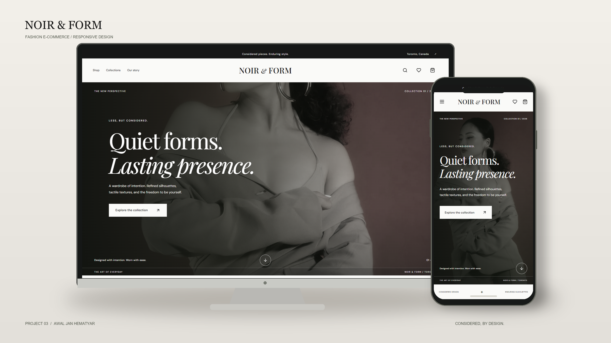

# NOIR & FORM

A premium fashion e-commerce portfolio demo for a fictional Toronto brand.

[Live website](https://noir-and-form-umber.vercel.app) · [Source](https://github.com/awaljanhematyar/noir-and-form) · [Case study](docs/portfolio/case-study.md)



## Case study

The storefront demonstrates a complete shopping journey: discover products through combined URL-based filters, choose a stock-aware size/color variant, save a wishlist, manage a persistent cart and complete an explicitly simulated checkout. The focus is state consistency across browsing, product selection and checkout.

## Release

React 19, Vite, JavaScript, Tailwind CSS v4, React Router and Lucide React. Thirty fictional products, responsive editorial design, combined filtering, stock-aware variants, persistent wishlist/cart and validated simulated checkout.

Build, lint, 14 unit/integration tests and 17 local Chrome browser tests pass. See [QA evidence and limitations](docs/QA.md) for live verification and measured performance.

Checkout uses illustrative CAD shipping and tax. No real payments, orders, fulfillment or message delivery. Only wishlist/cart persist; personal form details and confirmation do not.

## Documentation

- [PRD.md](PRD.md): scope, routes, catalog, journeys, shopping/form behavior, and acceptance targets.
- [architecture.md](architecture.md): implemented components, data/state, persistence, tests, and deployment.
- [design.md](design.md): authoritative approved visual system and accessible UI guidance.
- [rules.md](rules.md): engineering constraints and approval boundaries.
- [phases.doc.md](phases.doc.md): phase deliverables, validation, and gates.
- [memory.md](memory.md): actual progress, decisions, and remaining work.
- [CODEX_MASTER_PROMPT.md](CODEX_MASTER_PROMPT.md): execution brief and standing authorization.

## Run locally

Requires Node.js 22.19+ (Node 24 used for development and release) and npm.

```sh
git clone https://github.com/awaljanhematyar/noir-and-form.git
cd noir-and-form
npm ci
npm run dev
npm run build
npm run preview
npm run lint
npm test
npm run test:browser
```

Browser tests use installed Chrome at the Windows path in playwright.config.js. Set `CHROME_PATH` to a legitimate installed browser executable on another machine, and `BASE_URL` to the preview or live origin. Start `npm run preview` before browser tests. No environment secrets are needed by the application.

## Implemented experience

- Editorial homepage, 30-product shop, collection index/details, product pages, About, Contact, policies, wishlist/cart/checkout/confirmation, and custom 404.
- Combined URL-based search/category/collection/size/color/price filters, sorting, and Load more.
- Image galleries, explicit size/color selection, variant-specific demo stock, quantity caps, saved wishlist and cart, resilient storage and cross-tab updates.
- Validated local-only forms, honest demo confirmation, integer CAD calculations, and no payment/card/backend integration.
- Responsive layouts, native keyboard-accessible dialogs, focus handling, image fallbacks, reduced-motion styles, critical shopping routes in the shell and lazy informational routes, local fonts, and responsive local images.

## Engineering and evidence

See [CODE_GUIDE.md](docs/CODE_GUIDE.md) for responsibilities and comment conventions, [ASSETS.md](docs/ASSETS.md) for photo/font rights and limitations, and [memory.md](memory.md) for actual validation and release status. Browser evidence is recorded under docs/qa; original captures and the device cover belong under docs/portfolio. A client-rendered SPA has crawler/social-preview and HTTP-404 limitations; no SSR or accessibility certification is claimed.

## Project structure

| Location | Responsibility |
| --- | --- |
| `src/app/` | Application composition |
| `src/components/` | Reusable interface components |
| `src/pages/` | Route-level experiences |
| `src/data/` | Product catalog and site content |
| `src/utils/` | Shared application utilities |
| `src/styles/` | Design system and responsive styles |
| `public/images/`, `public/fonts/` | Locally served visual assets |
| `scripts/` | Asset, metadata and verification helpers |
| `docs/` | Code guide, QA evidence and asset rights |

## Author

Built by [Awal Jan Hematyar](https://github.com/awaljanhematyar), Front-End Developer | React Developer.

[Explore my portfolio](https://hematyar-professional-portfolio.vercel.app/) · [Discuss a project](mailto:awaljanhematyar@gmail.com)
